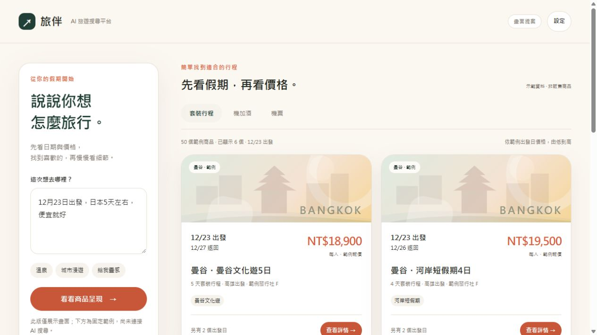
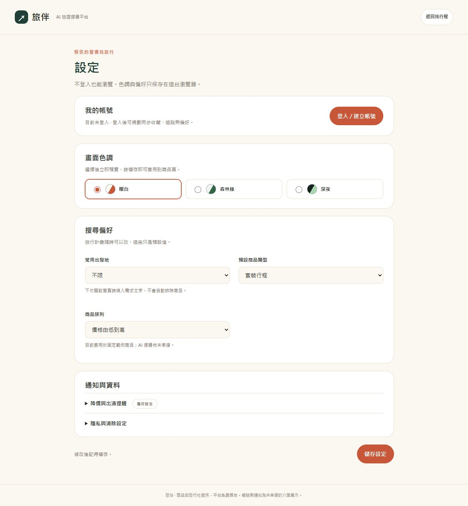
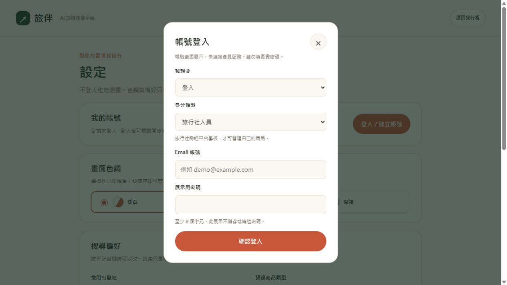
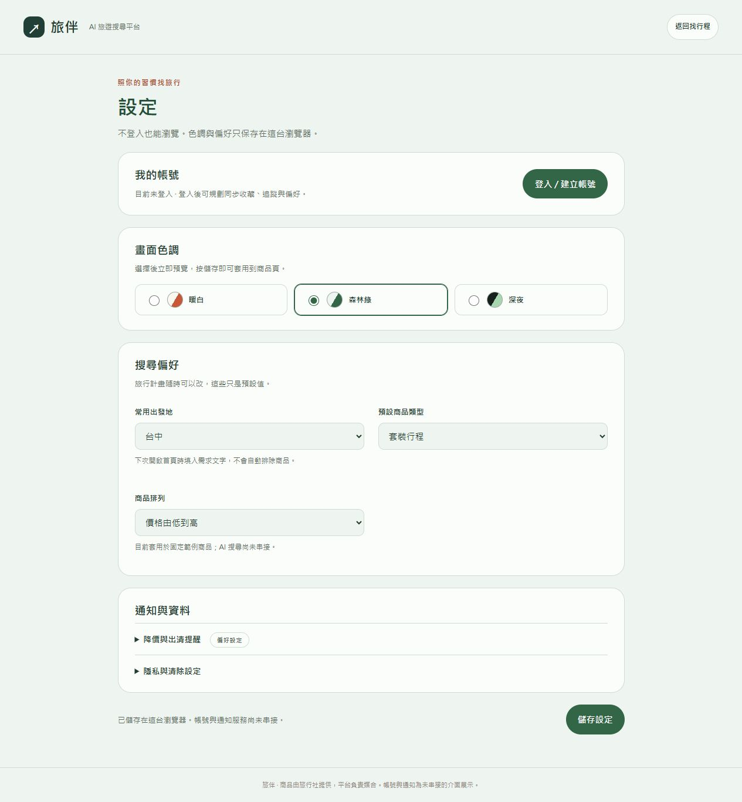
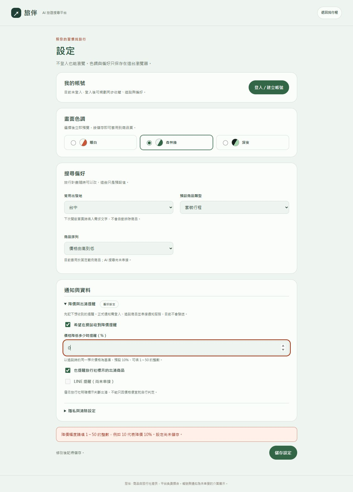
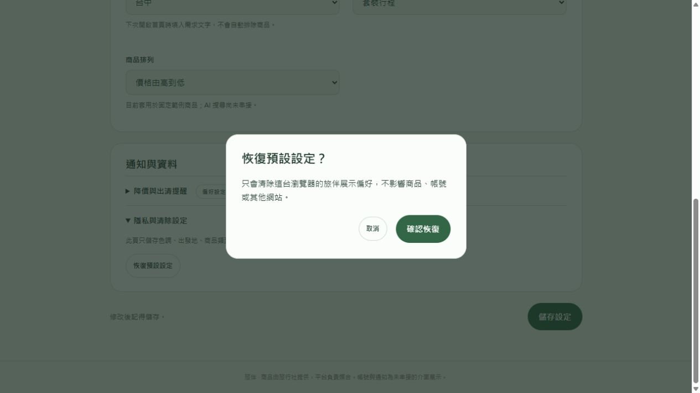
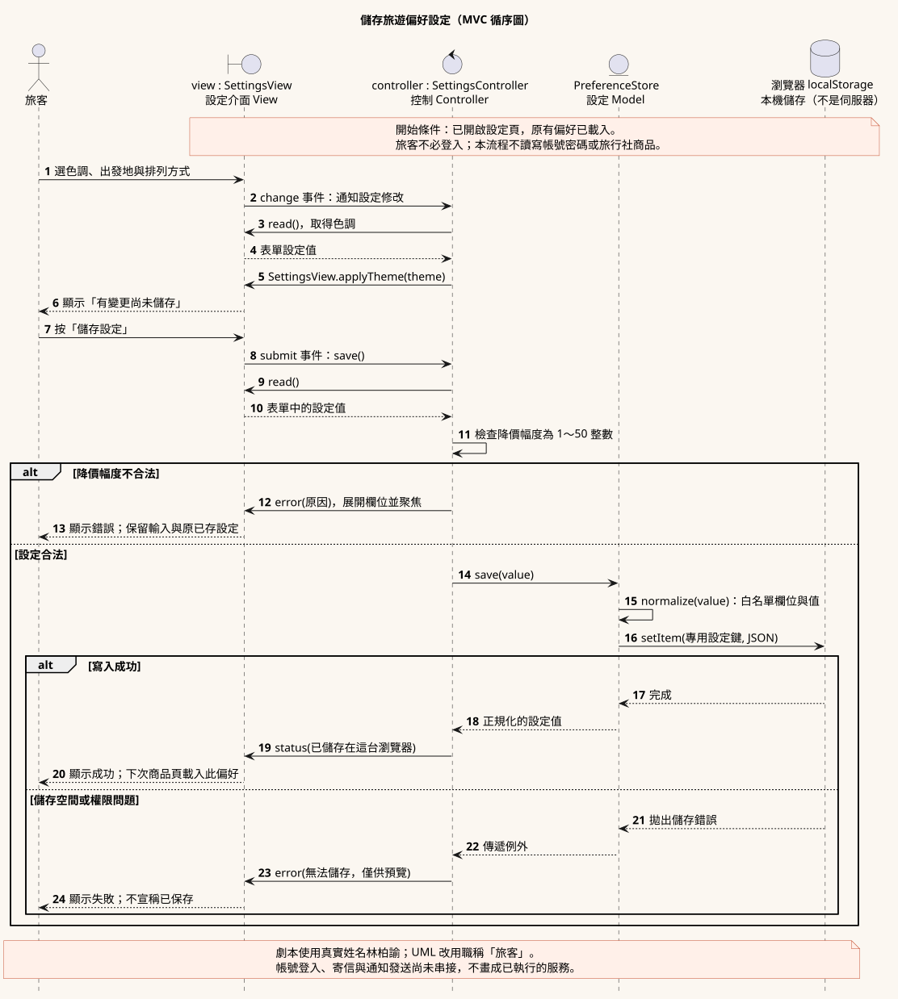
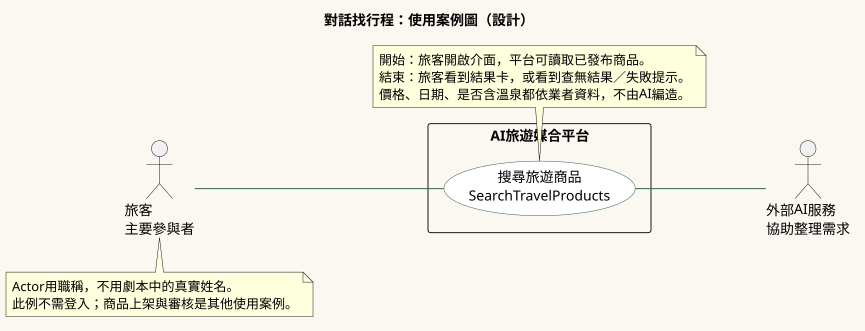
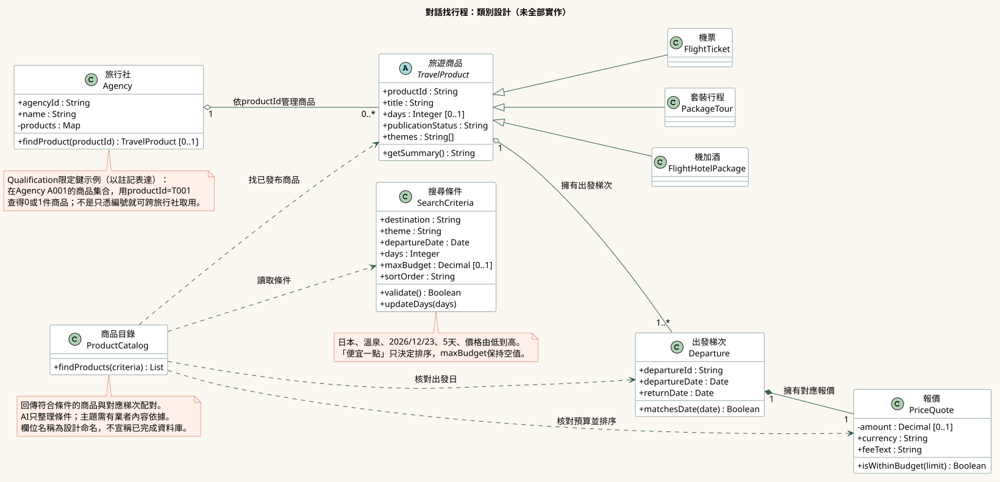

# 每週作業題目與答案

**產品：AI 對話媒合旅行社的套裝行程、機加酒與機票；無官網業者也能上架。**

以下為系統設計簡答；獨立展示已有商品類別圖與部分程式，完整平台及 AI 串接尚未完成。

## 9/19 分組

| 老師題目 | 我們的答案 |
| --- | --- |
| 分組名單 | 陳威任 4144W006、陳宏傑 4144W007、賴叔佑 4144W009、李慶寶 4144W010、劉宥伸 4144W013、林柏諭 4144W014。 |
| 小組組長 | 林柏諭（4144W014）。 |

## 10/3 專題題目與 UML 工具

| 老師題目 | 我們的答案 |
| --- | --- |
| 專題題目 | AI 旅遊搜尋平台：以 AI 對話媒合旅行社的套裝行程、機加酒與機票。平台沒有自有商品，無官網業者也能上架。 |
| 大系統 | 涵蓋旅客搜尋、業者商品管理與管理員審核，包含帳號、商品、梯次、報價和對話等資料。 |
| 創新 | 用聊天或語音表達需求，帶出旅遊商品卡；需要靈感時提供目的地與影片建議。 |
| 吸引力 | 旅客不用逐家整理搜尋條件；業者多一個展示商品、接觸旅客的入口。 |
| 技術可行 | 規劃以網頁、資料庫及外部 AI API 實作；AI 整理需求，商品日期與價格由後端查詢。 |
| 多種類別 | 可分析 User、Agency、TravelProduct、Departure、PriceQuote、Conversation 等類別。 |
| 資料分類／繼承 | TravelProduct 可分成 PackageTour、FlightHotelPackage、FlightTicket。例如日本五天團、機票加四晚住宿、單獨機票。 |
| UML 工具 | 使用 PlantUML 繪圖，可輸出 PNG、SVG；例：描述旅遊商品及三個子類別，產生繼承類別圖。 |
| 工具能力（老師建議） | 目前用於繪圖，尚未建立 UML 自動產生應用程式碼或程式碼反向產圖的流程。 |

## 10/17 需求分析

| 老師題目 | 我們的答案 |
| --- | --- |
| 1. Introduction：目的、動機 | 協助旅客快速找到符合日期與預算的商品，並讓旅行社有共同的上架與媒合入口。 |
| 2. Current system：比較四個系統 | 保留原四個系統，另加入易遊網與三個國外平台，共八個參考系統。老師原要求仍是三個類似系統加本系統。 |
| 3. Proposed system：提出的系統 | 旅客以對話找商品，業者提交自己的商品，管理員審核後發布；平台負責展示與媒合。 |
| 3.1 Overview：系統概述 | 輸入需求 → AI 整理條件 → 查商品 → 顯示旅遊卡 → 看詳情 → 聯絡業者。例：輸入「12月23日，日本五天，三萬元內」，查看符合條件的行程。 |

| 系統 | 功能與優點 | 限制／分析 | 我們可參考的地方 |
| --- | --- | --- | --- |
| [雄獅旅遊](https://travel.liontravel.com/order/choose?groupid=26JH927TRH-ZP&normgroupid=ef86e3b8-5dc2-43d1-8e0c-6ab2e3173d20) | 呈現行程、出發日期與價格。 | 起價不等於所選日期及人數的最終價格。 | 分開顯示梯次日期與對應報價。 |
| [可樂旅遊](https://www.colatour.com.tw/webDM/Portal/intro/ordertour.html) | 可先選行程，也可先選日期。 | 旅客仍需自行設定條件；操作負擔待測。 | 保留日期與目的地兩種查找入口。 |
| [品冠旅遊](https://www.pktravel.com.tw/japan/hokkaido) | 字卡呈現特色、日期與起價。 | 指定日期的實際費用須查商品。 | 用短文字突出行程特色。 |
| [易遊網](https://www.eztravel.com.tw/) | 團體旅遊、機加酒、機票及日期篩選。 | 商品類別與優惠多；找團步驟待測。 | 標示供應業者，初期聚焦三種商品。 |
| [TourRadar](https://www.tourradar.com/) | 整合多家業者的多天行程、價格與評價。 | 國際機票一般不包含，須查各商品。 | 清楚呈現天數、價格、業者與包含項目。 |
| [Travelstride](https://www.travelstride.com/) | 比較行程與業者，展示 AI 客製規劃入口。 | AI 客製方案與現成商品須分開比較。 | 區分靈感建議與真實業者商品。 |
| [TravelSupermarket](https://www.travelsupermarket.com/) | 比較套裝假期，轉往業者網站完成訂購。 | 價格可能變動，稅費與附加項目需確認。 | 清楚標來源與前往業者的入口。 |
| 本平台（規劃） | 對話搜尋、日期與價格優先、業者上架。 | 依賴商品更新，AI 理解與成效待驗證。 | 先做好日期、報價及商品來源。 |

我們的設計重點：以出發日期與價格找真實業者商品，支援無官網業者上架，並用簡單對話減少操作。Travelstride 已展示 AI 功能，因此不把「有 AI」說成獨有優勢。

本平台採用三項方向：TourRadar 的一致商品資訊、Travelstride 的旅遊建議，以及 TravelSupermarket 的業者轉接。介面採「聊天輸入 → 商品卡 → 完整詳情 → 聯絡業者」；商品卡先呈現日期、對應價格、天數與旅行社，其他日期、飯店、餐點與費用放詳情。靈感標為旅遊建議，不當作可購買商品；價格與包含項目依業者內文。

[獨立畫面提案](獨立展示/index.html)：下載後開啟；組員可編輯，正式整合位置待確認。

網站功能依官方資料查閱（2026/10/14）；限制與參考方向含設計分析，尚未實測操作優劣。TourRadar 機票說明：[官方 FAQ](https://www.tourradar.com/contact)。Travelstride 依官方搜尋索引查閱，未實測 AI。

## 11/7 功能與非功能需求

以下是作業版的未來需求設計，例子為設計資料；不代表AI、帳號或業者功能已完成。支援功能的開發優先順序另定。

### 3.2 功能性需求（19項）

| 功能 | 詳細答案與例子 |
| --- | --- |
| FR-01 AI／語音搜尋 | **做法：**旅客不必先登入，可打字或使用麥克風輸入需求。語音先轉文字，外部 AI 整理日期、目的地、天數與預算，後端核對條件後查已發布商品；不清楚的條件先追問。 **例子：**輸入「我想去日本」→ 系統詢問出發日 → 回答「2026/12/23，五天，三萬元內」→ 確認條件 → 顯示符合的旅行社商品卡。AI 失敗時保留文字，提供重試或一般篩選。 |
| FR-02 修改與還原條件 | **做法：**旅客可接著修改一個條件，系統保留沒有修改的條件；成功搜尋後記錄上一輪條件，供旅客還原。 **例子：**原條件為12/23、日本、五天、三萬元內 → 輸入「改成四天」→ 只改天數並重新找商品 → 按還原回到五天；查詢失敗不清空原條件。 |
| FR-03 快捷標籤 | **做法：**點選目的地、天數或主題標籤，可把需求文字加入輸入框，再由旅客確認送出；不把大量標籤一次攤開。 **例子：**點「日本」和「溫泉」→ 輸入框加入對應文字 → 自己補上日期並搜尋。重複或矛盾條件需提示調整，不能讓畫面與實際查詢不同。 |
| FR-04 篩選與排序 | **做法：**先篩選指定日期、目的地、天數、出發地及預算，再依旅客選擇排列價格。沒有目的地可查不同地點；「便宜就好」代表低價優先，不代表系統自行設定預算上限。 **例子：**指定12/23、日本五天、三萬元內 → 顯示同日25,000元、28,000元的行程。若無符合商品，先詢問是否接受鄰近日期；不把其他日期混成符合結果。 |
| FR-05 商品卡 | **做法：**把商品、所選梯次及其報價組成旅遊卡，突出出發日、價格、天數與旅行社。套裝行程、機加酒、機票只顯示各自適用欄位。 **例子：**卡片顯示「12/23出發、日本五天、每人28,000元、某旅行社」→ 點卡片開同一商品詳情。價格未知標「待確認」，測試資料清楚標示為範例。 |
| FR-06 商品詳情與來源 | **做法：**提供獨立頁面，呈現每日行程、不同日期報價、航班、飯店、餐點、費用及業者窗口；有官網可連到原商品，無官網業者使用經審核的平台商品頁。 **例子：**旅客看完北海道五天內容 → 換12/24，價格與回程一起更新 → 決定購買時前往業者商品頁或聯絡窗口。未提供的餐點、稅費標待確認；平台不自行承諾名額。 |
| FR-07 少量商品比較 | **做法：**旅客可自行加入2～3個商品，對照日期、對應價格、天數及出發地；比較是輔助功能，不要求旅客先比較才能聯絡業者。 **例子：**加入同日出發的兩個五天團 → 對照28,000元與30,000元及行程差異 → 選其中一個看詳情；加入第四筆時提示先移除一筆。 |
| FR-08 收藏與追蹤清單 | **做法：**保存旅客選擇的商品及梯次，支援取消收藏。訪客清單限同一裝置；登入後可選擇合併並去除重複，會員清單只對本人開放。 **例子：**先收藏12/23的日本五天行程 → 登入後合併到自己的清單 → 下次再看。收藏不代表訂位、保留價格或已開啟通知。 |
| FR-09 價格紀錄 | **做法：**取得可信的新報價後，記下同商品、同梯次、相同費用條件的價格及觀測時間；讀取畫面本身不新增價格紀錄。 **例子：**同一梯次先記錄40,000元，之後記錄36,000元 → 清單顯示兩筆日期與價格；不同出發日、幣別或方案不能直接算成降價。沒有紀錄時明確顯示。 |
| FR-10 降價／出清提醒 | **做法：**旅客可設定降價門檻、出清提醒及關閉通知。有效新報價達門檻才建立網站通知；LINE需完成對應串接與綁定後使用。出清必須有業者標示，不能只因便宜就稱出清。 **例子：**基準價40,000元、門檻10% → 同梯次降到36,000元且仍有效 → 建立一筆通知；再次檢查同一事件不重複發送。過期、未知價格不觸發降價提醒。 |
| FR-11 Email註冊與驗證 | **做法：**以Email作為帳號，旅客填密碼與顯示名稱後建立待驗證帳號；有效驗證連結只能使用一次，過期可申請重寄。一般註冊不會取得業者或管理員權限。 **例子：**填資料 → 系統檢查Email與密碼 → 寄出驗證信 → 點有效連結啟用 → 可以登入；寄信失敗需提示，不宣稱已成功寄達。 |
| FR-12 登入、登出與角色入口 | **做法：**登入後依角色提供旅客、旅行社及管理員功能；每次受保護操作都由後端驗證身分與權限。登出後仍可瀏覽公開商品。 **例子：**旅客登入只見自己的收藏；業者登入可管理自己的商品；管理員可審核。旅客直接輸入後台網址，也不能讀寫業者草稿。 |
| FR-13 忘記密碼 | **做法：**使用Email申請限時、一次性的重設連結；新密碼通過規則後更新，撤銷舊登入狀態。畫面不公開某個Email是否已註冊。 **例子：**提交Email → 收到重設信 → 設新密碼 → 使用新密碼登入；舊連結第二次使用或過期時拒絕，提供重新申請入口。 |
| FR-14 業者商品草稿 | **做法：**旅行社人員建立或修改自己的商品、梯次、價格、內容及窗口，儲存草稿與版本。外部商品網址可選填，讓無官網旅行社也能準備上架。 **例子：**無官網業者填日本五天商品及LINE窗口 → 儲存草稿 → 修改價格再存一個版本。旅客搜尋不到未發布草稿，業者也不能修改其他公司的草稿。 |
| FR-15 商品送審 | **做法：**業者完成資料後送審，系統檢查必要欄位並記錄狀態、版本與時間；業者可看退回原因，修正後再送。 **例子：**業者送審 → 狀態變待審核 → 管理員退回「請補費用說明」→ 業者補資料並再送。已待審的同一份資料不重複建立送審紀錄。 |
| FR-16 審核與發布 | **做法：**管理員核對來源、商品內容、日期、報價與業者窗口，選擇核准發布或附原因退回；發布時商品、梯次及報價要一起完成。 **例子：**管理員核准資料完整的商品 → 平台建立公開商品頁 → 旅客搜尋得到；費用不清楚的商品退回後仍不公開。寫入失敗不能留下半套已發布資料。 |
| FR-17 管理總覽 | **做法：**管理員查看待審商品、處理狀態與必要統計，再進入對應項目處理；查看總覽不會自動核准或改價。 **例子：**總覽有兩份待審 → 打開第一份並退回 → 回總覽時該份顯示需修改。查詢失敗顯示重試提示，不能把錯誤當成零筆待審。 |
| FR-18 旅遊靈感與影片 | **做法：**旅客目的地未定時，AI提供少量旅遊建議及理由；旅客確認後才改搜尋條件。規劃每5張商品卡搭配1張相關影片卡，影片與可購買商品分開，來源及授權方式仍待確認。 **例子：**旅客說「12月想玩雪，地點不限」→ 看建議後選日本 → 系統查日本商品。影片只補充介紹，不能當作價格或可售證據；沒有可信來源時不編造影片或商品。 |
| FR-19 個人設定 | 從首頁或詳情進入設定頁，選色調、常用出發地、商品類型、排序與通知偏好。例：林柏諭選森林綠、台中出發並儲存，下次首頁沿用。錯誤不寫入，恢復預設前先確認。展示的偏好僅存在本機；帳號、寄信與通知發送尚未串接。 |

### 物件導向（OO）對照

上述需求適合用物件導向設計。需求表說明系統要做什麼，再透過類別、資料與方法分配責任；目前已有前端示例，完整平台仍待逐步完成。

| 需求 | 對應物件與方法 |
| --- | --- |
| 旅行社管理商品 | Agency：透過 addProduct() 加入商品、findProduct() 查找自己的商品集合。 |
| 商品有不同出發日期 | TravelProduct、Departure：透過 quoteAt(index) 取得指定梯次。 |
| 每個日期有對應價格 | PriceQuote：保存金額與費用說明，透過 label 等 getter 提供讀取。 |

- **封裝：**PriceQuote 用私有欄位 #amount 保存金額，建立時檢查價格，外部透過 getter 讀取。
- **繼承：**PackageTour（套裝行程）、FlightHotelPackage（機加酒）、FlightTicket（機票）繼承 TravelProduct（旅遊商品）。
- **多型：**商品卡統一呼叫 getSummary()，不同商品子類別回傳自己的摘要。
- **擁有關係：**旅行社有商品，商品有出發梯次，每個梯次有對應報價。

**上台說法：**「我們把旅行社、商品、梯次與報價設計成不同物件，讓每個物件管理自己的資料，並透過方法合作完成需求。」

這些例子對應目前的前端示範；商品集合查找不等於後端權限驗證，也不表示完整AI系統已完成。

### 3.3 非功能性需求

以下說明系統在操作、品質與維護方面的規劃。

| 需求分類 | 我們的做法 |
| --- | --- |
| 3.3.1 哪些使用者會使用？ | 主要有旅客、旅行社人員和管理員，分別負責找行程、上架商品和審核商品。旅客可以先搜尋，不必一進網站就登入。 |
| 3.3.1 是否有多種類型的使用者？ | 有。不同角色看到不同功能：旅客看收藏，旅行社看自己的商品，管理員看審核清單；系統也會檢查權限，不能只靠隱藏按鈕。 |
| 3.3.1 使用者需要哪些教學？ | 旅客提供搜尋例句；旅行社提供填商品、送審和修改的說明；管理員提供審核步驟。例如業者照填寫範例完成商品後，就能送出審核。 |
| 3.3.1 容易學會是否重要？ | 重要。旅客輸入「12/23，日本五天，三萬元內」就能開始找行程，不用先學會一整套篩選操作。缺少日期等重要條件時，系統再詢問。 |
| 3.3.1 是否應防止操作錯誤？ | 會。資料不合理時，指出需要修改的地方，並保留其他已填內容。例如回程早於出發日，系統會請使用者修正日期。 |
| 3.3.1 有哪些輸入／輸出設備？ | 可用鍵盤、滑鼠、手機觸控或麥克風輸入，結果顯示在螢幕上；影片聲音由喇叭或耳機播放。不方便說話或不能使用麥克風時，仍可打字搜尋。 |
| 3.3.2 需要哪些文件？ | 提供旅客操作說明、旅行社上架說明、管理員審核說明，以及開發人員使用的程式與UML文件。內容應跟目前版本一致。 |
| 3.3.2 文件讀者 | 旅客看如何找行程，旅行社看如何上架，管理員看如何審核；開發與維運人員看程式架構及問題處理方式，讓每個人容易找到自己需要的內容。 |
| 3.3.3 硬體考量 | 使用者可用能上網的電腦、手機或平板。AI運算和商品查詢由伺服器處理，使用者不需要準備高階電腦。 |
| 3.3.4 效能特性 | 搜尋應快速回應，等待AI時顯示處理中。若超過設定時間仍沒有結果，就保留原需求，提示使用者重試或改用一般篩選；實際速度仍需測試。 |
| 3.3.5 錯誤與極端情況 | 系統要說清楚是輸入有誤、沒有符合行程，還是服務暫時失敗。例如找不到12/23的日本團，就詢問是否改日期，不能編出行程或價格。 |
| 3.3.6 系統串接 | 語音先轉成文字，AI再整理旅遊條件，後端確認後查旅行社商品；註冊與忘記密碼會使用郵件服務。任何服務失敗都要顯示提示。 |
| 3.3.7 品質問題 | 日期、價格與費用以旅行社提供的資料為準，缺資料就標待確認。例如搜尋滑雪時，行程要真的包含滑雪活動；切換出發日也要顯示該日價格。 |
| 3.3.8 系統修改 | 不同功能分開管理，修改時保留版本並更新相關說明。例如更換AI服務後，仍要確認日期和預算能正確傳給商品搜尋；出問題時可回復原版本。 |
| 3.3.9 實際使用環境 | 要能在電腦和手機上清楚操作。吵雜場所可改用文字；傳送途中斷線時，保留本頁已輸入的需求，讓使用者恢復網路後重試。 |
| 3.3.10 安全問題 | 旅客只能看自己的私人資料，旅行社只能修改自己的商品。例如A旅行社不能改B旅行社的價格。密碼不存明文，AI金鑰留在後端，重設密碼連結需限時且只能使用一次。 |
| 3.3.11 資源與管理 | 旅行社更新商品，管理員審核，工程師維護系統並備份資料。AI用量設上限；到上限後暫停新的AI請求，但仍可用一般搜尋找行程。 |

## 11/7 使用者情境

**老師補充要求**

選擇系統的一個功能，用真實姓名寫出完整使用劇本，明確定義情境中的資料、使用者操作與畫面變化，讓使用者能照著操作，避免後續功能修改及與客戶的紛爭。

**功能：對話找行程｜使用者：林柏諭**

設計劇本，假設找到四筆商品；目前展示尚未串接AI。

1. **開啟網站：**林柏諭看到對話框和行程卡，提示文字寫著「從這裡輸入需求，尋找行程」。
2. **輸入想法：**他點對話框，輸入「日本泡溫泉，便宜一點」，按「找尋行程」。畫面顯示他的訊息與追問。
3. **補充日期：**系統詢問出發日與天數。他輸入「2026/12/23，五天」，核對條件後按「確認搜尋」，畫面顯示搜尋中。
4. **挑選行程：**搜尋完成後，右側顯示四張符合的旅遊卡，價格由低到高排列，卡上有日期、天數、價格與旅行社。
5. **查看與聯絡：**他點卡片看行程、住宿、餐點和費用；喜歡就按「聯絡旅行社」，開啟業者商品頁或 LINE 窗口。按返回可繼續看原本的卡片。

| 老師要求（依課堂補充整理） | 本例如何符合 |
| --- | --- |
| 1. 全部相關資料（產生、修改、刪除、讀寫） | 建立對話及日本、溫泉、出發日、天數、排序等條件；讀取旅行社商品、梯次、報價與詳情；補充需求後更新條件及結果。按清除並確認，只刪本頁搜尋暫存，不刪業者商品。 |
| 2. 使用者全部介面操作（鍵盤、滑鼠、語音等） | 林柏諭用滑鼠點輸入框、鍵盤打字，點搜尋、確認條件、旅遊卡、返回及聯絡按鈕。若用語音，先點麥克風並授權，說完後核對文字再送出；也可取消改打字。 |
| 3. 系統全部介面及變化（文字、圖形、設定檔等） | 首頁顯示對話框與卡片；送出後顯示訊息、追問及條件摘要；確認後顯示搜尋中、四張結果卡；點卡片開啟詳情，再前往業者窗口。此搜尋不修改設定檔；設定功能的操作圖另附於下方。 |

**修改與例外：**他可接著輸入「改四天」並確認，只更新天數；點清除並確認可重新開始。查無結果時詢問是否調整條件；服務失敗保留輸入並提供重試。

看設定功能的操作圖片（6張）

**1. 開啟設定**：林柏諭點首頁右上角的「設定」。

**2. 閱讀設定**：畫面分成帳號、色調、搜尋偏好與通知四區。

**3. 選擇登入**：他選擇身分或註冊、忘記密碼；目前是介面展示，尚未連接帳號服務。

**4. 儲存偏好**：他選森林綠、台中出發，按儲存後顯示「已儲存在這台瀏覽器」。

**5. 輸入錯誤**：降價幅度填0時，畫面提示填1～50，不覆寫原設定。

**6. 恢復預設**：按恢復預設會先詢問；取消保留原設定，確認才清除本機偏好。

看設定功能的UML與程式分工

劇本說明怎麼操作；UML說明正式流程與物件責任。這張圖對應設定儲存，不是對話搜尋。

- View：SettingsView，顯示設定畫面。
- Controller：SettingsController，檢查及協調儲存。
- Model：PreferenceStore，讀寫本機偏好。

[可編輯UML原稿](獨立展示/04_UML圖表/03_MVC循序/設定功能循序圖.puml)

## 11/21 使用案例與類別分析

老師要求：選定UML工具；使用案例要有動詞＋名詞的名稱、參與職稱與外部系統、開始情境、正常事件流程、結束結果、例外及相關非功能性需求。流程以主動句寫出使用者操作與系統回應。

沿用11/7的「日本泡溫泉、便宜一點」情境。UML工具採PlantUML，保留可編輯原稿；以下是未來搜尋功能的正式設計，不代表AI與後端已完成。

老師原題與講義頁碼（3.5.3）

<pre>11/21	3.5.3 Class identification from use case models
		L12_p19 L12_p20
		1) 文字分析
		使用一個使用案例 使用文字分析找出對應的 類別圖(用UML Tool製作)
			名詞(資料) =&gt; class 類別
			動詞(計算) =&gt; function (***屬於受詞的 function)
			形容詞(data) =&gt; 類別內的資料(變數,物件)
-----------------------------
			3.5.3.1 Data dictionary
			3.5.3.2 Class diagrams
		2) 類別關聯性 L3_p24 L3_p25 L3_p26 L3_p33
			修飾上面3.5.3的類別圖,類別圖必須有範例:
			1) 繼承關聯性 2)擁有關聯性 3)類別Qualification(找出資料的key)
				a)繼承: 分類 (父類別 分成不同類型的 子類別) L3_p33
				b)擁有: 分解 一類別內擁有 另外一個類別的物件(資料) L3_p24 L3_p33
				c)類別Qualification (找出資料的 key):
				給一個Qualification的範例 L3_p25 L3_p26</pre>

### 3.5.2 使用案例：搜尋旅遊商品

| 老師要求 | 我們的答案 |
| --- | --- |
| 使用案例名稱 | SearchTravelProducts（搜尋旅遊商品）：Search是動詞，TravelProducts是名詞。 |
| 參與者（職稱＋系統） | 旅客是主要參與者；外部AI服務協助整理需求。這裡用職稱，不用劇本中的林柏諭。旅行社提供既有商品，上架與審核另屬其他使用案例。 |
| 開始情境 | 旅客已開啟搜尋頁；平台可讀取旅行社已發布的商品與梯次。不要求旅客先登入。 |
| 結束情境（結果） | 旅客看到符合條件的商品卡，並可開啟同一商品與梯次的詳情；沒有結果或服務失敗時，系統顯示對應說明，不編造商品。 |
| 相關非功能性需求 | 系統保留失敗前的輸入、明確顯示處理狀態；後端核對AI整理的條件，價格與內容以業者來源為準；AI用量達上限時提供一般搜尋。 |

正常流程：旅客操作與系統回應（5步）

| 使用者操作（主動句） | 系統回應（主動句） |
| --- | --- |
| 1. 旅客輸入「日本泡溫泉，便宜一點」，按搜尋。 | 系統顯示旅客訊息，請外部AI整理需求，再詢問缺少的出發日與天數。 |
| 2. 旅客回答「2026/12/23出發，五天」。 | 系統顯示日本、溫泉、12/23、5天、低價優先的摘要。系統不把「便宜」自行換成預算上限。 |
| 3. 旅客核對條件，按確認搜尋。 | 系統驗證條件、顯示搜尋中，讀取已發布商品及同一出發日的報價，核對溫泉內容後由低價排列。 |
| 4. 旅客閱讀結果卡。 | 本例假設找到四筆；系統顯示四張卡片，包含商品名稱、出發日、天數、該梯次價格與旅行社。 |
| 5. 旅客點其中一張卡片。 | 系統開啟該商品、該梯次的詳情；旅客可返回原結果。本案例不建立訂單或付款。 |

例外與替代流程

| 情況 | 處理方式 |
| --- | --- |
| 條件不足或日期無效 | 系統指出缺少或不合理的欄位，保留其他條件；旅客修正後回到確認步驟。 |
| 查無符合商品（替代結果） | 系統顯示查無結果，詢問是否調整日期、天數或預算；旅客同意後才修改。 |
| AI失敗、斷線或商品服務異常 | 系統保留輸入並顯示重試；AI無法使用時提供一般搜尋。系統不把故障顯示成零筆商品。 |

查看使用案例圖

[可編輯UML原稿](獨立展示/04_UML圖表/02_商品類別/搜尋使用案例.puml)

3.5.3 文字分析與資料字典

**老師要求：名詞（資料）→候選class；動詞（計算）→受詞所屬的function；形容詞→類別資料（變數或物件）。**

先找候選，再確認責任，不把每個名詞都硬做成類別。本例的旅客是Actor；帳號資料由其他功能處理。

**① 名詞 → 類別**

| 名詞 | 候選類別 | 責任 |
| --- | --- | --- |
| 搜尋條件 | SearchCriteria | 保存目的地、主題、日期、天數、預算與排序。 |
| 商品目錄 | ProductCatalog | 依條件找出商品與對應梯次的配對。 |
| 旅行社 | Agency | 保存業者資料及所屬商品集合。 |
| 旅遊商品 | TravelProduct | 保存名稱、主題與發布狀態。 |
| 出發梯次 | Departure | 保存同商品某次出發及回程日期。 |
| 報價 | PriceQuote | 保存該梯次金額、幣別及費用說明。 |

**② 動詞 → 受詞的方法**

| 動詞與受詞 | 所屬類別的方法 | 作用 |
| --- | --- | --- |
| 驗證「搜尋條件」 | SearchCriteria.validate() | 檢查日期、天數、預算等條件。 |
| 修改「搜尋條件的天數」 | SearchCriteria.updateDays(4) | 只改成4天，保留其他條件。 |
| 查詢「商品目錄」 | ProductCatalog.findProducts(criteria) | 取得符合條件的商品與梯次。 |
| 核對「梯次日期」 | Departure.matchesDate(date) | 判斷這個梯次是否符合指定日期。 |
| 檢查「報價」是否在預算內 | PriceQuote.isWithinBudget(limit) | 有預算上限才判斷；未知價格不能當作0元。 |

**③ 形容詞 → 資料**

| 描述 | 所屬欄位 | 例子 |
| --- | --- | --- |
| 已發布的商品 | TravelProduct.publicationStatus | published，讓旅客能查詢。 |
| 便宜一點的行程 | SearchCriteria.sortOrder | price-asc，只表示價格由低到高，不產生預算上限。 |
| 未知的報價 | PriceQuote.amount | null，畫面顯示待確認，不能當作免費。 |

3.5.3.1 資料字典：類別圖的欄位

| 欄位 | 型別 | 意義與例子 |
| --- | --- | --- |
| SearchCriteria.destination | 字串 | 日本；目的地。 |
| SearchCriteria.theme | 字串 | 溫泉；以業者內容核對。 |
| SearchCriteria.departureDate | 日期 | 2026-12-23；希望出發日。 |
| SearchCriteria.days | 正整數 | 5；希望旅遊天數。 |
| SearchCriteria.maxBudget | 可空金額 | null；未指定預算上限，不能改成0。 |
| SearchCriteria.sortOrder | 列舉值 | price-asc；價格由低到高。 |
| Agency.agencyId | 字串 | A001；旅行社識別值。 |
| Agency.name | 字串 | 範例旅行社A；業者名稱。 |
| Agency.products | Map<商品編號,商品> | T001對應一件TravelProduct；key在該業者內唯一。 |
| TravelProduct.productId | 字串 | T001；該業者的商品編號。 |
| TravelProduct.title | 字串 | 日本溫泉五天；商品名稱。 |
| TravelProduct.days | 可空正整數 | 5；機票等不適用時可留空。 |
| TravelProduct.publicationStatus | 列舉值 | published；只有已發布商品進入搜尋。 |
| TravelProduct.themes | 字串陣列 | [溫泉]；業者內容有依據的主題。 |
| Departure.departureId | 字串 | D001；此出發梯次的識別值。 |
| Departure.departureDate | 日期 | 2026-12-23；實際商品出發日。 |
| Departure.returnDate | 日期 | 2026-12-27；實際回程日。 |
| PriceQuote.amount | 可空金額 | 29900；未知時用null，不當作0元。 |
| PriceQuote.currency | 字串 | TWD；報價幣別。 |
| PriceQuote.feeText | 字串 | 業者上架的費用說明，不自行推定含稅。 |

三種商品子類別繼承共同欄位；ProductCatalog負責查詢，本圖沒有另設它的儲存欄位。

搜尋條件、商品目錄及新增搜尋方法為設計；既有展示目前只有部分商品資料類別。

3.5.3.2 類別圖與三種關聯性

| 老師要求 | 例子 |
| --- | --- |
| 繼承：是一種 | TravelProduct是父類別，PackageTour、FlightHotelPackage、FlightTicket是子類別。例：日本五天套裝團是一種PackageTour，共用商品欄位，提供自己的摘要。 |
| 擁有：裡面包含 | 一個商品擁有多個出發梯次，一個梯次擁有一份對應報價。例：T001有12/23的D001和另一日期的D002，兩者價格各自保存。 |
| Qualification：用key找資料 | 先選旅行社，再用productId查它的商品集合，得到0或1筆。例：Agency A001以T001找到日本五天；找不到就回傳空值，不能取其他業者的商品代替。 |

限定鍵在圖上用註記說明；圖中的欄位與搜尋方法是設計命名，不等於現有程式。

[可編輯UML原稿](獨立展示/04_UML圖表/02_商品類別/搜尋類別設計.puml) · [既有商品物件與程式範例](獨立展示/04_UML圖表/02_商品類別/objects.html)

## 11/28 動態模型

| 老師題目 | 我們的答案 |
| --- | --- |
| 3.5.5 Sequence diagrams：MVC 循序圖 | [換日期看報價](獨立展示/04_UML圖表/03_MVC循序/sequence.html)：旅客 → ProductDetailView → ProductDetailController → TravelProduct → 顯示該梯次日期與價格。例：選 12/24，顯示 NT$29,100（虛構資料）；對話搜尋的循序圖仍待補。 |
| MVC 三種物件 | 本例 View 接收選單操作與顯示結果；Controller 取得選項並找梯次；Model 保存商品、梯次及報價。目前資料位於瀏覽器記憶體，尚未接資料庫。 |
| Activity Diagrams：活動圖 | 輸入 → AI 整理 → 驗證 → 查候選商品 → 取得相關資料 → 篩選排序 → 顯示結果；無符合商品時進入調整條件分支。 |
| Concurrency：並行設計 | 取得候選商品 ID 後，並行讀取梯次報價與業者資訊，再匯合、篩選並組卡片。例：同批 T001 同時讀 D001 報價及 A001 窗口資料。 |

## 12/5 狀態圖與功能導覽

| 老師題目 | 我們的答案 |
| --- | --- |
| StateChart Diagram：單一類別狀態 | 以商品草稿為例：草稿 → 送審 → 已發布；審核退回 → 修正草稿 → 再送審。業者送審，管理員核准或退回。 |
| Navigation Path：樹狀功能選項 | 首頁 → 對話搜尋 → 商品詳情 → 聯絡業者；首頁／詳情 → 設定；旅客帳號 → 收藏；業者帳號 → 商品草稿／送審；管理員 → 審核。例：業者從登入入口進入自己的商品管理。 |
